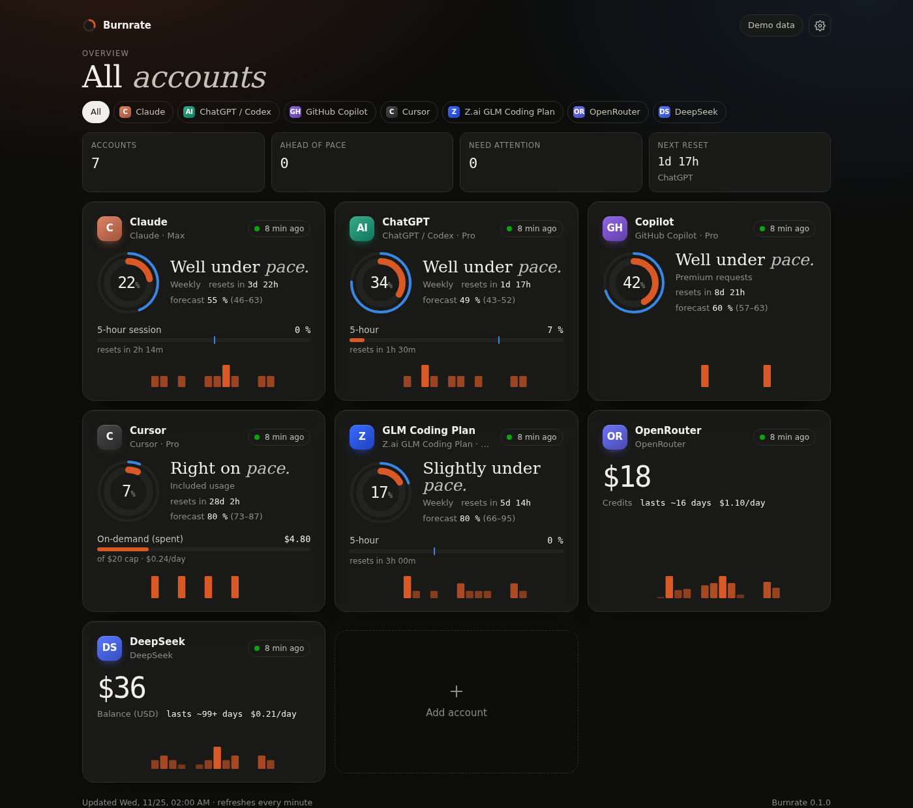
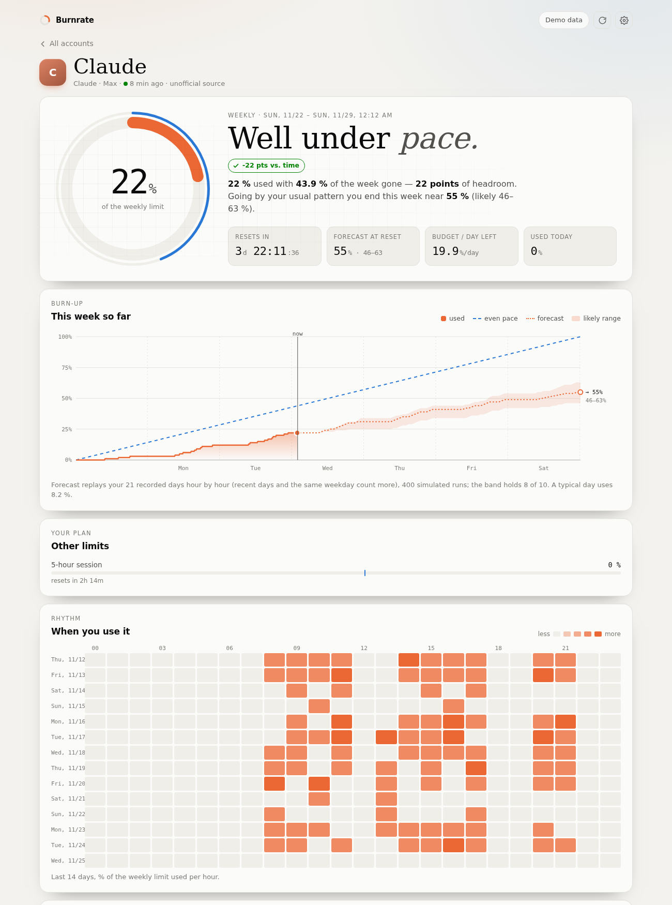
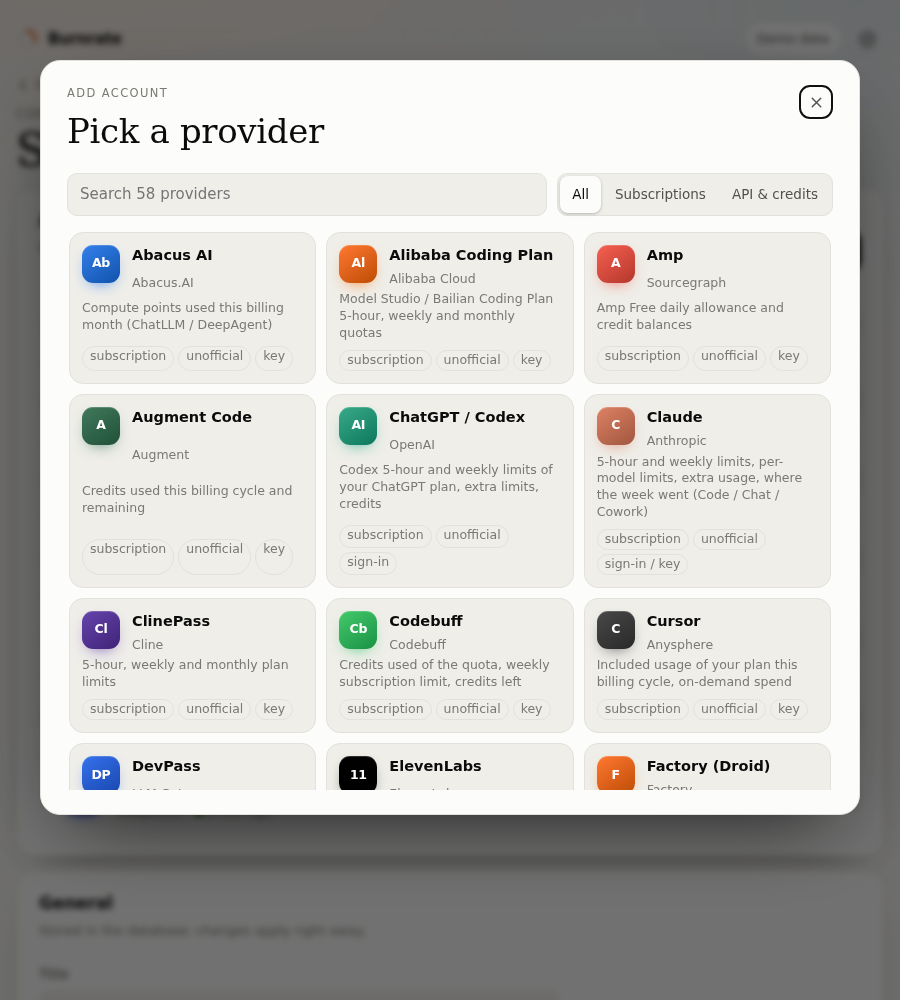

# Burnrate

[](https://github.com/TheOriUHD/burnrate/actions/workflows/ci.yml)   [](LICENSE)

**One self-hosted page for every AI plan you pay for.** Burnrate polls your Claude, ChatGPT, Copilot, Cursor, Gemini,
Z.ai, Kimi, Mistral, OpenRouter, DeepSeek … accounts (58 providers), keeps the history, and tells you whether you are on pace: how much of
each limit is used, how much of the window has passed, and where you are likely to end up at the reset.



- **All accounts at once, or one provider at a time.** Every limit window (5-hour, weekly, monthly, per model) and every
  balance, with a graded verdict: *Slightly ahead of pace*, *Right on pace*, *Running hot*.
- **A forecast from your own usage pattern, not a straight line.** Recorded days are replayed hour by hour (recent days
  and the same weekday count more), 400 times, to give the likely end-of-window value, the 10–90 % range and the
  chance of hitting the limit, with the time it would happen.
- **History:** burn-up chart of the current window, 14-day hour heatmap, per hour, per day, peak of each past window,
  spend per day for balances, how long a balance lasts.
- **Sign-in flows in the browser:** API keys, OAuth with a pasted code, device codes (enter a short code at
  openai.com / github.com). Several accounts per provider are fine (work and personal).
- **Integrations:** Prometheus `/metrics`, a JSON API, and a compact `/api/wall` for dashboards and wall displays.
- **Tiny:** Python standard library only, SQLite, one process, ~30 MB RAM. One-line install on Windows, Linux and
  macOS, or Docker. [Get it running →](#get-it-running-2-minutes)

<p> </p>

## Get it running (2 minutes)

### 1. Install

Pick one. Every option keeps your data when you update.

| You have | Run this | Then open |
|---|---|---|
| **Windows** (PowerShell) | `irm https://raw.githubusercontent.com/TheOriUHD/burnrate/main/install.ps1 \| iex` | http://127.0.0.1:8090 (opens by itself) |
| **Linux / macOS** | `curl -fsSL https://raw.githubusercontent.com/TheOriUHD/burnrate/main/install.sh \| sh` | http://127.0.0.1:8090 (opens by itself) |
| **Docker** | see below | http://localhost:8090 |

The one-line installers need only **Python 3.11+**; the Windows one offers to install Python with winget if it is
missing. They start Burnrate now and at every login, for your user only, no admin rights. To update, run the same line
again.

<details>
<summary><b>Docker</b></summary>

```bash
docker run -d --name burnrate --restart unless-stopped -p 8090:8090 -v burnrate-data:/data \
  -e TZ=Europe/Berlin ghcr.io/theoriuhd/burnrate:latest
docker logs burnrate          # shows the one-time setup code
```

Or with Compose: `git clone https://github.com/TheOriUHD/burnrate && cd burnrate && docker compose up -d`
(see [`compose.yaml`](compose.yaml)). Update: `docker pull ghcr.io/theoriuhd/burnrate:latest`, then recreate the container.
</details>

<details>
<summary><b>Plain Python, no installer</b></summary>

```bash
git clone https://github.com/TheOriUHD/burnrate && cd burnrate
BURNRATE_DATA=./data python3 -m burnrate          # nothing to pip install
```

On a server, [`burnrate.service`](burnrate.service) is a hardened systemd unit for this.
</details>

### 2. Open the page

- **Installer:** it opens straight away, no login, because it only listens on your own computer.
- **Docker or `--lan`:** the first visit asks for a **setup code**. It is in the log (`docker logs burnrate`, or the
  log file the installer prints). Enter it and choose a password.

### 3. Add your first account

**Settings → Add account**, pick the provider, follow the steps in the dialog. The most common ones:

| Provider | What to do |
|---|---|
| **Claude** (Pro, Max, Team) | *Sign in with Claude.ai*: log in, copy the code shown on the page, paste it back. |
| **ChatGPT / Codex** (Plus, Pro) | *Sign in with a code*: enter the short code at openai.com. |
| **GitHub Copilot** | *Sign in with GitHub*: enter the short code at github.com/login/device. |
| **Gemini** | *Sign in with Google*. |
| **Mistral** (Vibe, API) | Paste an API key: a Vibe key from chat.mistral.ai/code/extensions or a key from console.mistral.ai. |
| **OpenRouter, DeepSeek, xAI, …** | Paste the API key from the provider's dashboard. |
| **Cursor, Perplexity, …** | Paste the session cookie (the dialog says where to find it). |

The numbers appear after the first poll (a few seconds). The forecast gets better once a day or two of history exists.
To look around before connecting anything, try the [demo](#demo).

<details>
<summary><b>Installer options: phone access, port, autostart, uninstall</b></summary>

By default the installers listen only on `127.0.0.1` with no login. `--lan` / `-Lan` makes Burnrate reachable from your
phone or other devices and turns the password login on.

```powershell
# Windows: options need this form instead of "| iex"
& ([scriptblock]::Create((irm https://raw.githubusercontent.com/TheOriUHD/burnrate/main/install.ps1))) -Lan -Port 9000
& ([scriptblock]::Create((irm https://raw.githubusercontent.com/TheOriUHD/burnrate/main/install.ps1))) -Uninstall
```

```bash
# Linux / macOS
curl -fsSL https://raw.githubusercontent.com/TheOriUHD/burnrate/main/install.sh | sh -s -- --lan --port 9000
curl -fsSL https://raw.githubusercontent.com/TheOriUHD/burnrate/main/install.sh | sh -s -- --uninstall
```

Also: `--no-autostart` / `-NoAutostart`. Uninstall asks before deleting your data.

| | Windows | Linux / macOS |
|---|---|---|
| Program | `%LOCALAPPDATA%\Burnrate\venv` | `~/.local/share/burnrate/app` |
| Data (back this up) | `%LOCALAPPDATA%\Burnrate\data` | `~/.local/share/burnrate/data` |
| Settings (port, listen, login) | `%LOCALAPPDATA%\Burnrate\start-burnrate.cmd` | `~/.local/share/burnrate/burnrate.env` |
| Log | `data\burnrate.log` | `journalctl --user -u burnrate` (macOS: `data/burnrate.log`) |
| Autostart | shortcut in the Startup folder | systemd user service / LaunchAgent |
</details>

<details>
<summary><b>Something not working?</b></summary>

- **"Python 3.11+ is required"**: install it from [python.org](https://www.python.org/downloads/) (Windows: tick
  *Add python.exe to PATH*) or with `winget install Python.Python.3.13`, `brew install python`, `sudo apt install python3`.
- **`irm … | iex` is blocked**: your PowerShell execution policy forbids scripts. Run
  `Set-ExecutionPolicy -Scope CurrentUser RemoteSigned` once, then try again.
- **Port 8090 is taken**: reinstall with `--port 9000` / `-Port 9000`, or change `BURNRATE_PORT` in the settings file.
- **Page doesn't open after a reboot**: on Linux without a desktop session, enable lingering once:
  `sudo loginctl enable-linger $USER`.
- **Account shows an error**: the card says why (expired login, wrong key). *Settings → the account → Reconnect*.
- **Lost the setup code**: restart Burnrate; until a password is set, every start prints a new code in the log.
</details>

### Demo

```bash
BURNRATE_DATA=/tmp/burnrate-demo python3 -m burnrate demo     # 7 made-up accounts, 3 weeks of history
BURNRATE_DATA=/tmp/burnrate-demo BURNRATE_AUTH=none python3 -m burnrate
```

## Configuration

Everything else (time zone, poll interval, theme, accounts, password, API token) is set in the web UI.

| Variable | Default | Meaning |
|---|---|---|
| `BURNRATE_DATA` | `./data` (`/data` in Docker, see the table above for the installers) | Database and `secrets.json`. Back this directory up. |
| `BURNRATE_LISTEN` / `BURNRATE_PORT` | `0.0.0.0` / `8090` | Where the web server listens. |
| `BURNRATE_AUTH` | `password` | `none` turns the login off: **only** behind a reverse proxy that authenticates (Authelia, TinyAuth, oauth2-proxy, Cloudflare Access …). |
| `BURNRATE_PASSWORD` | – | Sets the password at start, so no setup code is needed. |
| `TZ` | `UTC` | Default time zone for a new instance. |
| `BURNRATE_GEMINI_CLIENT_ID` / `_SECRET` | – | Gemini sign-in client. Not shipped; by default read once from the official Gemini CLI source on GitHub. |

**Security.** Credentials are kept server-side in `secrets.json` (mode 0600) and never sent to the browser. The UI is
same-origin only (JSON + fetch-metadata checks), the session cookie is `HttpOnly`. Put it behind HTTPS if it is
reachable from outside your network. Anyone who can open the page can see your usage, so keep the password on or the
proxy in front.

### Reverse proxy

```caddyfile
usage.example.com {
    reverse_proxy burnrate:8090
}
```

Set `X-Forwarded-Proto` (Caddy does this) so the session cookie is marked `Secure`.

## Providers

Many plans have no public usage API. For those Burnrate reads the internal endpoint the provider's own app or CLI uses
(marked *internal endpoint*). These can change without notice, and using them may go against a provider's terms of
service. Sign-ins that reuse a provider's own CLI client (Claude Code, Codex, Gemini CLI, Copilot) are the same ones
those tools do on your machine; Burnrate never sees your password.

<!-- providers:start (generated: python -m burnrate providers --markdown) -->
| Provider | Type | What you see | Connect with | Source |
|---|---|---|---|---|
| **Abacus AI** | subscription | Compute points used this billing month (ChatLLM / DeepAgent) | Session cookie | internal endpoint |
| **Alibaba Coding Plan** | subscription | Model Studio / Bailian Coding Plan 5-hour, weekly and monthly quotas | API key | internal endpoint |
| **Amp** | subscription | Amp Free daily allowance and credit balances | API key | internal endpoint |
| **Augment Code** | subscription | Credits used this billing cycle and remaining | Session cookie | internal endpoint |
| **ChatGPT / Codex** | subscription | Codex 5-hour and weekly limits of your ChatGPT plan, extra limits, credits | sign-in (device code), sign-in (paste code) | internal endpoint |
| **Claude** | subscription | 5-hour and weekly limits, per-model limits, extra usage, where the week went (Code / Chat / Cowork) | sign-in (paste code), Paste a token | internal endpoint |
| **ClinePass** | subscription | 5-hour, weekly and monthly plan limits | API key | internal endpoint |
| **Codebuff** | subscription | Credits used of the quota, weekly subscription limit, credits left | API key | internal endpoint |
| **Cursor** | subscription | Included usage of your plan this billing cycle, on-demand spend | Session cookie | internal endpoint |
| **DevPass** | subscription | DevPass cycle credits, premium weekly allowance, key spend | API key | internal endpoint |
| **ElevenLabs** | subscription | Credits (characters) used this cycle, voice slots | API key | official API |
| **Factory (Droid)** | subscription | 5-hour, weekly and monthly limits, standard/premium token allowance, extra usage balance | API key | internal endpoint |
| **Gemini Code Assist** | subscription | Daily request quotas per model (Gemini CLI / Code Assist) | sign-in (paste code) | internal endpoint |
| **GitHub Copilot** | subscription | Premium requests, chat and completions quotas per month | sign-in (device code), Paste a token | internal endpoint |
| **Kilo Code** | subscription | Kilo Pass credits used this period, credit balance | API key | internal endpoint |
| **Kimi Code** | subscription | Kimi coding plan: 5-hour, weekly and monthly windows | API key | internal endpoint |
| **Langdock** | subscription | Personal 5-hour session and weekly usage limits | Session cookie | internal endpoint |
| **LongCat** | subscription | Token allowance used, fuel packs left | Session cookie | internal endpoint |
| **Manus** | subscription | Monthly plan credits, refresh credits, total balance | Session cookie | internal endpoint |
| **MiniMax Coding Plan** | subscription | Coding/token plan: current window and weekly quota | API key | internal endpoint |
| **Mistral** | subscription | Vibe plan budget (chat + code) and the included-API budget with reset; spend limit and credits optional | API key, Console cookie, Admin API key only | official API |
| **Neuralwatt** | subscription | kWh used of the plan's energy allowance, prepaid balance, key allowance | API key | internal endpoint |
| **Ollama Cloud** | subscription | Included cloud usage (session/weekly or monthly allowance), purchased credit | API key | internal endpoint |
| **OpenCode Go** | subscription | Go subscription 5-hour, weekly and monthly quotas | API key | internal endpoint |
| **Perplexity** | subscription | Credit balance, usage this period, renewal date | Session cookie | internal endpoint |
| **Qoder** | subscription | Model credits used (own + shared quota), next reset | Session cookie | internal endpoint |
| **Raycast AI** | subscription | AI credits left of this period's total, next refill | Session cookie | internal endpoint |
| **StepFun Step Plan** | subscription | Coding Plan 5-hour and weekly windows, or Token Plan credit pool | Session token | internal endpoint |
| **Synthetic** | subscription | Weekly plan limit and rolling 5-hour limit | API key | official API |
| **T3 Chat** | subscription | 4-hour base usage window and monthly overage | Session cookie | internal endpoint |
| **Trae CN** | subscription | Credits used of the current entitlement (trae.cn) | Session cookie | internal endpoint |
| **Warp** | subscription | AI requests used in this refresh period, bonus credits | API key | internal endpoint |
| **Windsurf** | subscription | Daily and weekly quota left, plan end | Session bundle | internal endpoint |
| **Xiaomi MiMo Token Plan** | subscription | Token-plan credits used this period | API key | internal endpoint |
| **Z.ai GLM Coding Plan** | subscription | Coding plan windows (5-hour, weekly), tool calls per month; China: account balance | API key | internal endpoint |
| **Zed** | subscription | Edit predictions used, token spend against your spend limit | Session cookie | internal endpoint |
| **ZenMux** | subscription | Subscription 5-hour and 7-day flow quotas, pay-as-you-go balance | API key | internal endpoint |
| **Anthropic API** | API / credits | Organization spend this month (cost report), optional monthly budget | API key | official API |
| **Deepgram** | API / credits | Requests, audio hours, tokens and TTS characters in the current usage period (all projects) | API key | official API |
| **DeepInfra** | API / credits | Prepaid balance (or amount owed), spend this month, billing-cycle limit | API key | internal endpoint |
| **DeepSeek** | API / credits | Account balance (topped up and granted) | API key | official API |
| **Exa** | API / credits | Spend of one API key this month (Team Management API) | API key | official API |
| **fal** | API / credits | Credit balance | API key | official API |
| **Fireworks AI** | API / credits | Spend this month | API key | official API |
| **GroqCloud** | API / credits | Spend, requests and tokens this month and today (console activity) | Session cookie | internal endpoint |
| **Hugging Face** | API / credits | Inference Providers usage this month (included credits, billable, limit), ZeroGPU quota | API key | internal endpoint |
| **LiteLLM** | API / credits | Personal and team budget of your LiteLLM proxy key, spend so far | API key | official API |
| **Moonshot API** | API / credits | Open platform balance (cash and voucher) | API key | official API |
| **OpenAI API** | API / credits | Organization spend this month (Costs API), optional monthly budget | API key | official API |
| **OpenRouter** | API / credits | Credit balance, key spend limit, spend today/this week/this month | API key | official API |
| **Poe** | API / credits | Compute points balance | API key | official API |
| **Replicate** | API / credits | Spend this month (current invoice), prepaid credit | Session cookie | internal endpoint |
| **SiliconFlow** | API / credits | Account balance (purchased and bonus) | API key | internal endpoint |
| **Tavily** | API / credits | Plan credits used, key limit, pay-as-you-go credits | API key | official API |
| **v0** | API / credits | v0 credit balance and on-demand balance | API key | official API |
| **Venice** | API / credits | USD and DIEM balances, DIEM used of this epoch's allocation | API key | internal endpoint |
| **Vercel AI Gateway** | API / credits | AI Gateway credit balance and total used | API key | official API |
| **xAI API** | API / credits | Prepaid credit balance (team billing, management API) | API key | official API |
<!-- providers:end -->

Not possible today: per-message limits for **Mistral Vibe** chat (Mistral exposes the monthly Vibe budget, which Burnrate shows), **Gemini** consumer AI
Pro/Ultra (Google closed the Gemini CLI sign-in for personal accounts in June 2026), **JetBrains AI** (only local IDE
files). Missing one? See [CONTRIBUTING.md](CONTRIBUTING.md): a provider is one small Python class.

## API

| Endpoint | |
|---|---|
| `GET /api/overview` | All accounts with their windows, balances, verdicts and forecasts. |
| `GET /api/accounts/<id>` | One account with full history (hourly, daily, heatmap, burn-up, forecast curve). |
| `GET /api/wall?account=<id>` | Compact JSON of one account's main window (default: the *main account* from Settings). |
| `GET /metrics` | Prometheus: `burnrate_window_used_percent`, `burnrate_window_forecast_percent`, `burnrate_window_reset_timestamp`, `burnrate_balance`, `burnrate_up`, `burnrate_last_success_timestamp`. |
| `GET /healthz` | Liveness, no login. |

With a password set, scripts use the API token from **Settings → Security**:
`Authorization: Bearer <token>` or `?token=<token>` (read-only: overview, wall, metrics).

```yaml
# prometheus.yml
- job_name: burnrate
  metrics_path: /metrics
  authorization: { credentials: <token> }
  static_configs: [{ targets: ["burnrate:8090"] }]
```

## How the numbers work

- **Pace:** used % against the share of the window that has passed. Within ±1.5 points it is *right on pace*; ±5
  *slightly*; ±15 *ahead/under*; beyond that *well ahead/under*; more than 25 points ahead or ≥ 90 % used is *running hot*.
- **Forecast:** every past day with at least 20 sampled hours becomes a 24-hour usage profile. For the rest of the
  window each remaining day replays one of those days, chosen with weight 0.5^(age / 10 days), ×3 for the same weekday
  and ×1.5 for the same weekday/weekend kind. 400 runs give the median, the 10–90 % band, the share of runs that reach
  100 % and the median time they do. Until one full day is recorded it falls back to a straight line.
- **Per hour / per day:** increases of the used % between samples (a reset counts the new value); gaps put the whole
  increase into the first hour after the gap. Balances: spend is the drop of a remaining balance (top-ups ignored)
  or the rise of a spend figure.

## Development

See [CONTRIBUTING.md](CONTRIBUTING.md). Tests: `python -m unittest discover -s tests -v`.

## License

MIT. Not affiliated with any of the providers; all names and trademarks belong to their owners.
